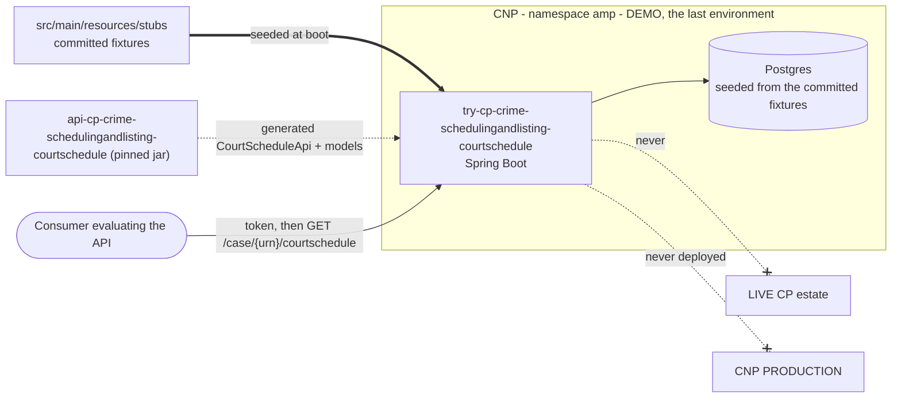

# try-cp-crime-schedulingandlisting-courtschedule

A sandbox implementation of the **Scheduling and Listing Court Schedule API**, so a prospective
consumer can call the API and see real response shapes *before* requesting access to the live one.

It implements the generated interface from
[`api-cp-crime-schedulingandlisting-courtschedule`](https://github.com/hmcts/api-cp-crime-schedulingandlisting-courtschedule).
It holds no Common Platform data, has no route to a CP backend, and is not intended to acquire one.

| | |
|---|---|
| Product / component | `amp` / `try-slc` |
| Platform | CNP (Jenkins + Flux), namespace `amp` |
| Contract | `uk.gov.hmcts.cp:api-cp-crime-schedulingandlisting-courtschedule:1.1.2` |
| Backend dependencies | **none** |
| Design | [Try it now service](https://hmcts.atlassian.net/wiki/spaces/AMP/pages/327713375/Try+it+now+service) on Confluence — the source of truth for the design |

## Documentation

| | |
|---|---|
| [docs/consumer-flow.md](docs/consumer-flow.md) | Calling the sandbox: scenarios, tokens, credentials, how the auth works |
| [docs/contract-defects.md](docs/contract-defects.md) | Defects in the published contract that this work surfaced |
| [docs/cnp-build-deploy-test.md](docs/cnp-build-deploy-test.md) | Building, deploying and testing a service on CNP |
| [CNP-ONBOARDING-PLAN.md](CNP-ONBOARDING-PLAN.md) | Onboarding status for this service |
| [CLAUDE.md](CLAUDE.md) | Repo conventions and the debugging table |

## Architecture



**Nothing writes to it but itself.** There is no upload path: the examples are the fixtures
committed under `src/main/resources/stubs/`, validated against the published contract at build time
and seeded into Postgres at boot. Changing what a consumer sees means changing the repository.

The database is there because it is the store the service was built around, and because a write
path is expected to come back — see [#37](https://github.com/hmcts/try-cp-crime-schedulingandlisting-courtschedule/pull/37).
Today it holds exactly what the repository holds.

**It makes no call to the Common Platform, ever.** It answers from its own store, which is what lets
it live in CNP with no CP connectivity and no route to the live estate. There is no CP-to-CNP
peering, and `cnp-cp-integration` is an empty repo.

**Two token realms, set per environment** by `auth.key-source` — the same `EntraTokenValidator`
either way, differing only in where the verification keys come from:

| | `SELF_ISSUED` | `ENTRA` |
|---|---|---|
| Token issued by | this service, at `/oauth2/v2.0/token` | Microsoft Entra |
| Keys | held in memory — no outbound call at all | the tenant's JWKS, fetched over HTTPS |
| Demo credentials | published in `/scenarios` | none; the token and JWKS endpoints do not exist |
| Needs | nothing | `AUTH_TENANT_ID`, `AUTH_AUDIENCE`, `AUTH_ISSUER`, and an app registration |

`ENTRA` is the default, so an environment nobody configured fails closed at startup rather than
accepting tokens this service minted itself. The realms are mutually exclusive by construction: in
`ENTRA` the signing key, the minter and both demo endpoints leave the context, so the service cannot
issue a token it would then have to reject. `GET /scenarios` reports which realm is live under
`authentication.mode` — see [docs/consumer-flow.md](docs/consumer-flow.md).

A consequence worth stating plainly: **everything this sandbox serves is in the repository.** If a
case URN appears here, it was written into `stubs/scenarios.yaml` and reviewed in a pull request.

## Quick start

```bash
BASE=https://amp-try-slc.demo.platform.hmcts.net   # VPN required - see Deployment

curl -s $BASE/scenarios        # unauthenticated: case URNs, credentials, what each shows
```

`/scenarios` is the entry point and documents itself. The full walkthrough — token, call, the seven
scenarios and the two demo clients — is in [docs/consumer-flow.md](docs/consumer-flow.md).

## Local development

### 1. Start Postgres

```bash
docker run -d --name tin-pg -e POSTGRES_PASSWORD=postgres -e POSTGRES_DB=tryitnow \
  -p 55432:5432 postgres:16-alpine
```

**55432, not 5432, and the reason is worth knowing.** A natively installed Postgres listening on
`127.0.0.1:5432` shadows a Docker container published on the same port — the specific bind beats
Docker's wildcard — and the app then fails with `FATAL: role "postgres" does not exist`. That reads
like a credentials problem and is really a wrong-server problem.

### 2. Set the environment

Everything the service reads is an environment variable with a default in `application.yaml`. There
is no local Spring profile: what you run locally is configured exactly the way a deployed
environment is, which is the point.

[`.env.example`](.env.example) is the committed template. Copy it and let
[direnv](https://direnv.net/) load it, the same way `service-cp-crime-hearing-results-document-subscription`
does:

```bash
cp .env.example .env          # .env and .envrc are already git-ignored
printf 'dotenv\n' > .envrc    # tells direnv to load .env
direnv allow
```

`brew install direnv`, then [hook it into your shell](https://direnv.net/docs/hook.html). Without
direnv, export the variables yourself or put them in front of the command — direnv only saves you
from retyping them.

**Never commit `.env`.** Deployed environments take their secrets from the `amp-try-slc-{env}` key
vault, mounted by Flux.

| Variable | Default | What it does |
|---|---|---|
| `AUTH_KEY_SOURCE` | `ENTRA` | **Set this to `SELF_ISSUED` locally.** The default fails closed so an unconfigured deployed environment cannot accept self-minted tokens; locally you want the sandbox to mint its own |
| `POSTGRES_HOST` | `localhost` | |
| `POSTGRES_PORT` | `5432` | **Set this to 55432** — see above |
| `POSTGRES_DATABASE` | `tryitnow` | |
| `POSTGRES_USER` | `postgres` | |
| `POSTGRES_PASS` | `postgres` | |
| `DEMO_SIGNING_KEY_JWK` | empty | Unset, an ephemeral key is generated and a warning logged — correct locally. Generate your own if you need one stable across restarts; never copy a deployed environment's |
| `RECORDING_SEED_FIXTURES` | `true` | false shows how a genuinely empty environment behaves |
| `SERVER_PORT` | `8080` | |

### 3. Run it

```bash
./gradlew build      # compile, contract-check fixtures, integration tests
./gradlew bootRun
curl localhost:8080/scenarios
curl localhost:8080/health
```

If `bootRun` exits with

```
auth.key-source=ENTRA but AUTH_TENANT_ID is still the self-issued sandbox value
```

that is the check working, not a fault: `AUTH_KEY_SOURCE=SELF_ISSUED` is missing from your `.env`.

`./gradlew build` needs Docker running — the store and the full ingest/publish journey are tested
against a real Postgres via TestContainers, not an in-memory substitute.

The `api-cp-*` artefact resolves from the HMCTS Azure Artifacts feed. To build against an unreleased
spec, publish it locally first:

```bash
cd ../api-cp-crime-schedulingandlisting-courtschedule
./gradlew publishToMavenLocal -DAPI_SPEC_VERSION=1.1.3
```

Two defects found by running the service, both fixed and covered by regression tests — worth knowing
about because both are easy to reintroduce:

- **CORS preflight returned 401.** `OPTIONS` carries no `Authorization` header, so the auth filter
  rejected it and the browser abandoned the exchange before sending the real request. Try-it-out fails
  while curl succeeds.
- **`/health` would have CrashLoopBackOff'd the pod.** With `management.endpoints.web.base-path: /`,
  the inherited prefix rule cannot match `/health`, so the liveness probe would have been answered
  401. Note that `chart-java` probes `/health/liveness` and `/health/readiness`, not `/health` — see
  [docs/cnp-build-deploy-test.md](docs/cnp-build-deploy-test.md).

## Deployment

CNP, via Jenkins (`Jenkinsfile_CNP` → `withPipeline('java', 'amp', 'try-slc')`) and Flux. The method
is in [docs/cnp-build-deploy-test.md](docs/cnp-build-deploy-test.md); remaining onboarding steps are
tracked in [CNP-ONBOARDING-PLAN.md](CNP-ONBOARDING-PLAN.md).

**Demo is the last environment.** Sandbox, preview, AAT, then demo. There is no production deployment
of this service and there is not meant to be one.

| Environment | Host | Deployed by | Token realm |
|---|---|---|---|
| preview | `amp-try-slc-pr-{N}.preview.platform.hmcts.net` | Jenkins, **this repo's chart** | `SELF_ISSUED` |
| AAT staging | `amp-try-slc-staging.aat.platform.hmcts.net` | Jenkins, **this repo's chart** | `SELF_ISSUED` |
| sandbox | `amp-try-slc.sandbox.platform.hmcts.net` | Flux | `ENTRA` (`d44f885c…`) |
| AAT | `amp-try-slc.aat.platform.hmcts.net` | Flux | `ENTRA` (`d44f885c…`) |
| **demo** | `amp-try-slc.demo.platform.hmcts.net` | Flux | `SELF_ISSUED` — **the live one**, deployed since 13 Oct 2026 |
| production | — | — | **Deliberately none** |

**Which chart deploys which environment is the thing to get right here.** Jenkins builds from
`charts/amp-try-slc/` in this repo, so `values.preview.template.yaml` and
`values.aat.template.yaml` configure preview and the ephemeral staging slot. Flux deploys
`stable/amp-try-slc` from **`hmcts-charts`** — a separate published copy — overlaid with the
per-environment `HelmRelease` patches in `cnp-flux-config/apps/amp/amp-try-slc/{sbox,aat,demo}.yaml`.
**A change to `charts/amp-try-slc/values.yaml` in this repo does not reach sandbox, AAT or demo**
until that chart is republished. Set anything those three environments must have in the
`cnp-flux-config` patches, where it applies whatever chart version is live.

**Every Entra environment uses `hmctsextsbox`** — `d44f885c…`, audience `30288840…`. That is the
tenant `service-api-marketplace` and `web-api-marketplace` both run against, so it is where a
consumer's application is registered and granted `app.read`. The credentials a developer is actually
issued are therefore the ones these environments accept. The same pair is committed in
`api-cp-crime-schedulingandlisting-courtschedule`'s `preview.tfvars` and pinned by that API's APIM
`validate-jwt` policy.

**Preview and the AAT staging slot stay self-issued so CI can prove the 200 path.** Both exist to
run the functional stage, and the stage has no Entra client secret to fetch a token with — against
an `ENTRA` deployment it could only ever assert the 401, which is indistinguishable from a blocked
JWKS fetch. Self-issued, it mints a token and exercises the whole journey. The `ENTRA` realm is
verified against sandbox instead, where a real marketplace registration can be used.

**Demo stays self-issued for now.** It keeps the published demo credentials working, which is what
the public catalogue's Try-it-out needs — a browser cannot complete a `client_credentials` exchange
against Entra, so an Entra demo would have no browser journey at all. Which tenant it should
eventually validate against is not settled; when it is, three variables in
`cnp-flux-config/apps/amp/amp-try-slc/demo.yaml` replace one.

**Every one of these currently needs the VPN**, demo included. They are records in Azure *private*
DNS zones and no Front Door configuration exists for this service in `cnp-flux-config` — the demo
Flux patch sets `ingressHost` and nothing more.

That is a gap, not a design decision, and it blocks the thing demo exists for:

- **Consumers are meant to reach it from the public API catalogue.** Try-it-out is a browser call
  from `https://hmcts.github.io`, which is why CORS is configured through `demo.allowed-origins`.
  Without public reachability that call cannot land.
- **The production Marketplace issues try-it-now credentials against a demo-tier APIM.** The
  production `service-api-marketplace` calls the demo APIM to generate the API keys a developer uses
  here. That is a production service with a dependency on a demo environment — see the note in
  [CNP-ONBOARDING-PLAN.md](CNP-ONBOARDING-PLAN.md), because it is a real operational consequence
  rather than a detail.

There is no write surface to protect at the edge today. If one comes back, it must be restricted
there separately from the public read API — an ingest endpoint writes data that is one approval
away from being internet-readable.
