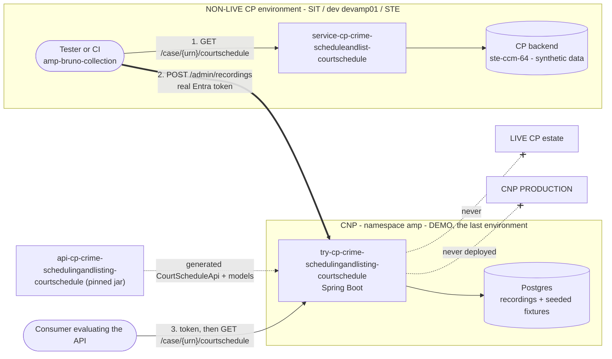

# try-cp-crime-schedulingandlisting-courtschedule

A sandbox implementation of the **Scheduling and Listing Court Schedule API**, so a prospective
consumer can call the API and see real response shapes *before* requesting access to the live one.

It implements the generated interface from
[`api-cp-crime-schedulingandlisting-courtschedule`](https://github.com/hmcts/api-cp-crime-schedulingandlisting-courtschedule).
It holds no Common Platform data, has no route to a CP backend, and is not intended to acquire one.

| | |
|---|---|
| Product / component | `amp` / `try-slc` |
| Platform | CNP (Jenkins + Flux), namespace `amp` |
| Contract | `uk.gov.hmcts.cp:api-cp-crime-schedulingandlisting-courtschedule:1.1.2` |
| Backend dependencies | **none** |
| Design | [Try it now service](https://hmcts.atlassian.net/wiki/spaces/AMP/pages/327713375/Try+it+now+service) on Confluence — the source of truth for the design |

## Documentation

| | |
|---|---|
| [docs/consumer-flow.md](docs/consumer-flow.md) | Calling the sandbox: scenarios, tokens, credentials, how the auth works |
| [docs/admin-flow.md](docs/admin-flow.md) | The recording pipeline: capture, ingest, review, publish |
| [docs/contract-defects.md](docs/contract-defects.md) | Defects in the published contract that this work surfaced |
| [docs/cnp-build-deploy-test.md](docs/cnp-build-deploy-test.md) | Building, deploying and testing a service on CNP |
| [CNP-ONBOARDING-PLAN.md](CNP-ONBOARDING-PLAN.md) | Onboarding status for this service |
| [CLAUDE.md](CLAUDE.md) | Repo conventions and the debugging table |

## Architecture



**Read the arrows by direction.** The thick arrow is the only thing that crosses into CNP, and it is
*inbound*: the capture runs in the non-live CP environment and pushes the response into demo over the
admin API. This service makes no outbound call to anything — it validates tokens against a key it
holds in memory and answers from its own store. That is what lets it live in CNP with no CP
connectivity and no route to the live estate, at capture time or at serve time.

**It is not a network path.** There is no CP-to-CNP peering, and `cnp-cp-integration` is an empty
repo. What crosses is an authenticated HTTPS client running in the CP environment calling a demo
host. The admin realm's Entra token is the whole of the control; the network provides none.

A consequence worth stating plainly: **the demo sandbox holds data captured from a non-live CP
environment, and nothing else.** If a case URN appears here, it came from SIT, dev or STE.

## Quick start

```bash
BASE=https://amp-try-slc.demo.platform.hmcts.net   # VPN required - see Deployment

curl -s $BASE/scenarios        # unauthenticated: case URNs, credentials, what each shows
```

`/scenarios` is the entry point and documents itself. The full walkthrough — token, call, the seven
scenarios and the two demo clients — is in [docs/consumer-flow.md](docs/consumer-flow.md).

## Local development

### 1. Start Postgres

```bash
docker run -d --name tin-pg -e POSTGRES_PASSWORD=postgres -e POSTGRES_DB=tryitnow \
  -p 55432:5432 postgres:16-alpine
```

**55432, not 5432, and the reason is worth knowing.** A natively installed Postgres listening on
`127.0.0.1:5432` shadows a Docker container published on the same port — the specific bind beats
Docker's wildcard — and the app then fails with `FATAL: role "postgres" does not exist`. That reads
like a credentials problem and is really a wrong-server problem.

### 2. Set the environment

Everything the service reads is an environment variable with a default in `application.yaml`. There
is no local Spring profile: what you run locally is configured exactly the way a deployed
environment is, which is the point.

[`.env.example`](.env.example) is the committed template. Copy it and let
[direnv](https://direnv.net/) load it, the same way `service-cp-crime-hearing-results-document-subscription`
does:

```bash
cp .env.example .env          # .env and .envrc are already git-ignored
printf 'dotenv\n' > .envrc    # tells direnv to load .env
direnv allow
```

`brew install direnv`, then [hook it into your shell](https://direnv.net/docs/hook.html). Without
direnv, export the variables yourself or put them in front of the command — direnv only saves you
from retyping them.

**Never commit `.env`.** Deployed environments take their secrets from the `amp-try-slc-{env}` key
vault, mounted by Flux.

| Variable | Default | What it does |
|---|---|---|
| `POSTGRES_HOST` | `localhost` | |
| `POSTGRES_PORT` | `5432` | **Set this to 55432** — see above |
| `POSTGRES_DATABASE` | `tryitnow` | |
| `POSTGRES_USER` | `postgres` | |
| `POSTGRES_PASS` | `postgres` | |
| `ADMIN_DISABLED` | `false` | **Set this true locally.** The admin realm verifies against a real corporate Entra tenant and refuses to start half-configured; true makes `/admin/**` answer 503 rather than leaving it unguarded |
| `ADMIN_TENANT_ID`, `ADMIN_AUDIENCE`, `ADMIN_ISSUER`, `ADMIN_JWKS_URI` | empty | Only needed with `ADMIN_DISABLED=false`, to work on the recording pipeline itself |
| `DEMO_SIGNING_KEY_JWK` | empty | Unset, an ephemeral key is generated and a warning logged — correct locally. Generate your own if you need one stable across restarts; never copy a deployed environment's |
| `RECORDING_SEED_FIXTURES` | `true` | false shows how a genuinely empty environment behaves |
| `SERVER_PORT` | `8080` | |

### 3. Run it

```bash
./gradlew build      # compile, contract-check fixtures, integration tests
./gradlew bootRun
curl localhost:8080/scenarios
curl localhost:8080/health
```

`./gradlew build` needs Docker running — the store and the full ingest/publish journey are tested
against a real Postgres via TestContainers, not an in-memory substitute.

The `api-cp-*` artefact resolves from the HMCTS Azure Artifacts feed. To build against an unreleased
spec, publish it locally first:

```bash
cd ../api-cp-crime-schedulingandlisting-courtschedule
./gradlew publishToMavenLocal -DAPI_SPEC_VERSION=1.1.3
```

Two defects found by running the service, both fixed and covered by regression tests — worth knowing
about because both are easy to reintroduce:

- **CORS preflight returned 401.** `OPTIONS` carries no `Authorization` header, so the auth filter
  rejected it and the browser abandoned the exchange before sending the real request. Try-it-out fails
  while curl succeeds.
- **`/health` would have CrashLoopBackOff'd the pod.** With `management.endpoints.web.base-path: /`,
  the inherited prefix rule cannot match `/health`, so the liveness probe would have been answered
  401. Note that `chart-java` probes `/health/liveness` and `/health/readiness`, not `/health` — see
  [docs/cnp-build-deploy-test.md](docs/cnp-build-deploy-test.md).

## Deployment

CNP, via Jenkins (`Jenkinsfile_CNP` → `withPipeline('java', 'amp', 'try-slc')`) and Flux. The method
is in [docs/cnp-build-deploy-test.md](docs/cnp-build-deploy-test.md); remaining onboarding steps are
tracked in [CNP-ONBOARDING-PLAN.md](CNP-ONBOARDING-PLAN.md).

**Demo is the last environment.** Sandbox, preview, AAT, then demo. There is no production deployment
of this service and there is not meant to be one.

| Environment | Host | Role |
|---|---|---|
| sandbox | `amp-try-slc.sandbox.platform.hmcts.net` | Build and rehearse |
| preview | `amp-try-slc-pr-{N}.preview.platform.hmcts.net` | Per-PR. Uninstalled at the end of each build unless the PR carries `enable_keep_helm` |
| AAT | `amp-try-slc.aat.platform.hmcts.net` | Jenkins also deploys an ephemeral `amp-try-slc-staging` for its test stages |
| **demo** | `amp-try-slc.demo.platform.hmcts.net` | **The live one.** Deployed since 13 Oct 2026 |
| production | — | **Deliberately none** |

**Every one of these currently needs the VPN**, demo included. They are records in Azure *private*
DNS zones and no Front Door configuration exists for this service in `cnp-flux-config` — the demo
Flux patch sets `ingressHost` and nothing more.

That is a gap, not a design decision, and it blocks the thing demo exists for:

- **Consumers are meant to reach it from the public API catalogue.** Try-it-out is a browser call
  from `https://hmcts.github.io`, which is why CORS is configured through `demo.allowed-origins`.
  Without public reachability that call cannot land.
- **The production Marketplace issues try-it-now credentials against a demo-tier APIM.** The
  production `service-api-marketplace` calls the demo APIM to generate the API keys a developer uses
  here. That is a production service with a dependency on a demo environment — see the note in
  [CNP-ONBOARDING-PLAN.md](CNP-ONBOARDING-PLAN.md), because it is a real operational consequence
  rather than a detail.

When demo does become public, `/admin/**` must be restricted at the edge, separately from the read
API. The ingest endpoint writes data that is one approval away from being internet-readable.
