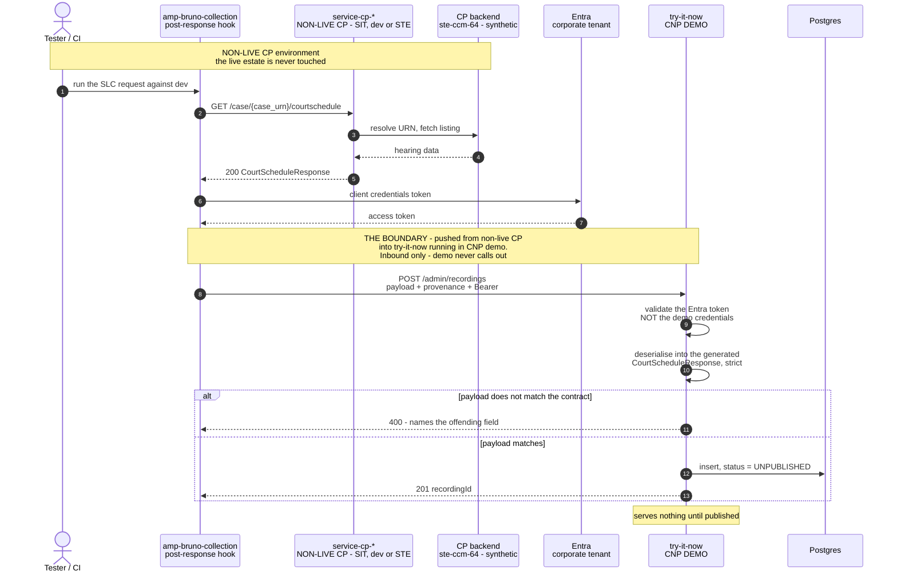
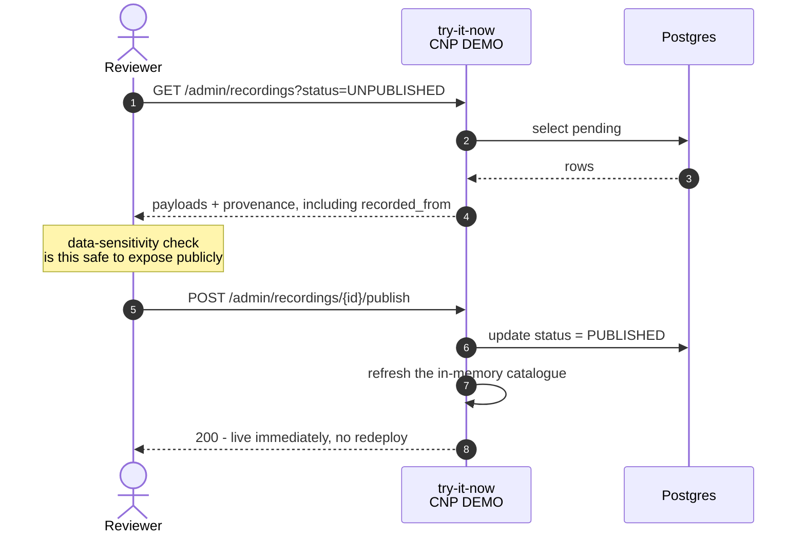

# Admin flow — the recording pipeline

How examples get into this sandbox. Examples are **recorded from the real service in a non-live CP
environment** and **pushed into the demo try-it-now running in CNP**, which then serves them.

Those are two different estates and two different environments, and the split is the point: the data
is real in *shape* because it came from the real service, and safe to publish because it came from a
non-production environment. Full design detail is on
[Confluence](https://hmcts.atlassian.net/wiki/spaces/AMP/pages/327713375/Try+it+now+service).

The read side is a separate journey with a separate auth realm — see
[consumer-flow.md](consumer-flow.md).

| Concern | Environment | Where |
|---|---|---|
| **Capture** a real response | **Non-live CP** — SIT, dev (`devamp01`) or STE, in front of the CP backend | `amp-bruno-collection`, run from that environment |
| **Push** across the boundary | From non-live CP **into** CNP demo | `POST /admin/recordings`, with a real corporate Entra token |
| **Validate** and store | **CNP demo** | Ingest endpoint on the demo try-it-now |
| **Serve** to consumers | **CNP demo** | Demo try-it-now, from Postgres |

Nothing in this flow reads the **live** CP estate, and nothing in it runs in the live CP estate. The
only crossing is the push, and it is initiated from the non-live CP environment — the demo service
never calls out.

**Demo being the last environment does not make this low-stakes.** Demo exists precisely so it can be
shown to people outside HMCTS. It is not publicly reachable yet (see the deployment table in
[../README.md](../README.md)), but it is intended to be, and a published recording is one Front Door
configuration away from the public internet. Everything below about the ingest gate, the two auth
realms and the publish review applies exactly as it would have in production — the only thing that
changed is which environment is the destination.

## Endpoints

| | |
|---|---|
| `POST /admin/recordings` | Ingest. Validates against the contract, stores `UNPUBLISHED`. Needs `app.recordings.write`. |
| `GET /admin/recordings?status=UNPUBLISHED` | What is awaiting review, with provenance and body. Needs `app.recordings.write`. |
| `POST /admin/recordings/{id}/publish` | Makes it live and refreshes the catalogue. Needs `app.recordings.publish`. |
| `POST /admin/recordings/{id}/archive` | Takes it out of service, keeping the record. Needs `app.recordings.publish`. |

Two roles, not one: capture is automated and frequent, publishing is the step that puts data in front
of the public. All four are guarded by `AdminAuthFilter` with a **real corporate Entra token** — never
the published demo credentials, which would otherwise open a write path into a deployed environment.

## Capture and ingest

## Review and publish

Recordings arrive **unpublished** and serve nothing. A separate, separately-authorised call makes one
live — ingest checks the *shape*, publish is where a human checks the *content* is fit to be public.

## What the design turns on

- **The ingest gate is the point.** The same contract check that runs at build time today moves to
  ingest time. A recording that does not fit the published contract is rejected with the field named.
- **Ingest authenticates with a real Entra token**, never the demo credentials — those are published
  in the catalogue and must not open a write path into a deployed environment. `/admin/**` should also
  be restricted at the edge, separately from the public read API.
- **Non-live as the source is a safety property, not a convenience.** Captures land in a demo service
  that is one approval away from being publicly readable, so the only thing standing between a real
  case and the public internet is the choice of source environment. Recording from live CP would
  defeat the design however carefully the review step is run. Confirm that the source environment
  holds synthetic data before recording anything; with SIT now named as a capture source, the question
  covers SIT as well as `ste-ccm-64`, and is still unanswered.
- **Provenance is recorded, not assumed.** Every row carries `recorded_from`, and the reviewer sees it
  on the publish screen. If a recording cannot name the non-live environment it came from, that is the
  signal to archive it rather than publish it.

## Adding or changing a scenario

Two ways in, and they meet at the same contract gate.

**A committed fixture** — the baseline a fresh environment starts with:

1. Add the body to `src/main/resources/stubs/`.
2. Register it in `src/main/resources/stubs/scenarios.yaml`.

**A recording** — captured from a real response, via `POST /admin/recordings`. It arrives unpublished
and serves nothing until someone with the publish role approves it.

Fixtures are seeded only for URNs with nothing published, so a recording that has superseded a fixture
is never reverted by a restart.

Both paths run the same `ContractValidator`, which deserialises the body into the generated model with
unknown-property checking on. A fixture that drifts fails the build (`FixtureLoaderTest`) and fails
startup; a recording that drifts is rejected at ingest with a 400 naming the offending field. That
check is why this service depends on the `api-cp-*` artefact rather than serving JSON from a file
server — and it is what a WireMock or Prism deployment could not give you. When the contract version in
`build.gradle` is bumped, anything that no longer fits turns the build red.

Because of `@JsonInclude(NON_NULL)` on the generated models, never write `"field": null` into a stub
expecting it to appear in the response — it is dropped. Use a real value or omit the field.
