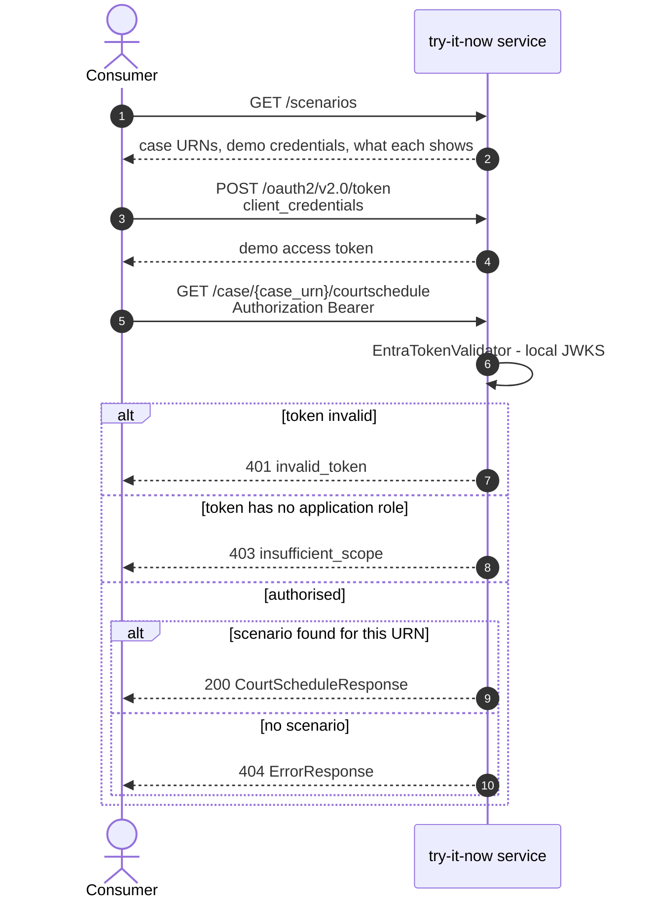

# Consumer flow

How someone evaluating the Scheduling and Listing Court Schedule API uses this sandbox: discover the
scenarios, get a token, call the API. Everything here is unauthenticated to discover and
authenticated to call, and all of it is public by design.

There is no write side today. What the sandbox serves is the set of fixtures committed under
`src/main/resources/stubs/`, seeded into its store at boot; changing it means a pull request.

## Which realm you are in

Two token realms, set per environment by `auth.key-source`. Ask the deployment rather than assuming:

```bash
curl -s $BASE/scenarios | jq .authentication
```

| `authentication.mode` | Where the token comes from | What exists |
|---|---|---|
| `self-issued` | `POST $BASE/oauth2/v2.0/token`, with the published demo credentials | token endpoint, `/.well-known/jwks.json`, `demoClients` in `/scenarios` |
| `entra` | `POST https://login.microsoftonline.com/{tenant}/oauth2/v2.0/token`, with **your own** app registration | none of the above — they are removed from the service, not merely refused |

Validation is the same code either way. The rest of this page describes the self-issued realm, which
is what local development and any environment without an app registration run; the
[Entra realm](#the-entra-realm) section covers the other.

## The journey



`GET /scenarios` is unauthenticated and self-documenting — it lists the credentials, the case URNs
and what each one demonstrates. It is the entry point; nothing else needs to be known in advance.

## Walkthrough

```bash
BASE=https://amp-try-slc.demo.platform.hmcts.net

# 1. Get a token (same client_credentials form post as Entra)
TOKEN=$(curl -s -X POST $BASE/oauth2/v2.0/token \
  -H 'Content-Type: application/x-www-form-urlencoded' \
  -d 'grant_type=client_credentials&client_id=11111111-1111-4111-8111-111111111111&client_secret=try-it-now-demo-secret' \
  | jq -r .access_token)

# 2. Call the API
curl -s -H "Authorization: Bearer $TOKEN" $BASE/case/TIN-ALLOCATED-01/courtschedule
```

Substitute the host for the environment you are pointed at — see the deployment table in
[../README.md](../README.md). All of them currently need the VPN.

## Scenarios

| Case URN | Status | Demonstrates |
|---|---|---|
| `TIN-ALLOCATED-01` | 200 | Allocated hearing with a court sitting |
| `TIN-WEEKCOMM-01` | 200 | Unallocated — empty `courtSittings` with a `weekCommencing` block |
| `TIN-MULTI-01` | 200 | Two hearings on one case, one of each kind |
| `TIN-EMPTY-01` | 200 | Case with no hearings — an empty array, still a 200 |
| `TIN-NOTFOUND-01` | 404 | No schedule for the URN (as does any unrecognised URN) |
| `TIN-BADREQUEST-01` | 400 | Malformed case URN |
| `TIN-SERVERERROR-01` | 500 | Backend failure, for exercising retry handling |

The 200s with an empty `courtSittings` or an empty `courtSchedule` are **valid responses, not
faults** — same as the live API (AMS handover pack §6.4).

The list `/scenarios` returns is **not in a stable order**. Filter on `status` or `path`; never index
into it.

## Demo credentials

Both published deliberately; they authorise nothing beyond this sandbox.

| Client | `client_id` | Outcome |
|---|---|---|
| Reader | `11111111-1111-4111-8111-111111111111` | Carries `app.read` — calls succeed |
| Unentitled | `22222222-2222-4222-8222-222222222222` | No role — every call answers **403** |

Secret for both: `try-it-now-demo-secret`. Presenting a wrong secret answers **401**. These are not
canned error bodies: the 401 and 403 come from the same validator that guards the live API.

## Why the auth is not a mock

The auth code is copied from `service-cp-crime-scheduleandlist-courtschedule` and runs in
`AUTH_MODE=ENFORCE`. `EntraTokenValidator`, `EntraAuthProperties`, `AuthMode`, `ValidatedCaller` and
`TokenValidationException` are **byte-identical** to their source — `diff` reports no change.
`AuthorizationPolicy` adds exempt paths, and the two filters diverge as documented in each file.
Tokens are verified for real: RS256 signature, exact `iss`/`tid`/`ver`/`aud`, `exp`/`nbf`,
`sub == oid` app-only assertion, prohibited `scp`, and a non-empty `roles` claim.

The single difference is the key source, and it is a configured one. `AppConfig` supplies either an
`ImmutableJWKSet` holding this service's own demo key (`SELF_ISSUED`) or a `JWKSourceBuilder` fetching
a tenant's JWKS over HTTPS (`ENTRA`). The first is what lets the sandbox run with **no egress at
all** — no CP network, no Entra.

In the self-issued realm this sandbox is its own issuer, so **a demo token is worthless against any
real API**: the `iss`, `aud` and `tid` are its own.

## The Entra realm

Set `AUTH_KEY_SOURCE=ENTRA` and the service verifies real Microsoft Entra app-only access tokens
against the issuing tenant's published keys. Three variables come with it, and startup fails naming
whichever is missing:

| Variable | Value |
|---|---|
| `AUTH_TENANT_ID` | Directory (tenant) id of the tenant **issuing** the tokens — not the hosting tenant |
| `AUTH_AUDIENCE` | This API's own application (client) id. A **bare GUID**: the validator pins `ver=2.0`, and a v2 token carries the GUID in `aud`, never `api://…` |
| `AUTH_ISSUER` | `https://login.microsoftonline.com/<tenant-id>/v2.0` |

What the app registration has to provide, because the validator imposes it:

- **`requestedAccessTokenVersion: 2`** on the API registration. Without it Entra issues v1 tokens with
  an `sts.windows.net` issuer, and the `ver`/`iss` checks reject every one.
- **An app role named `app.read`**, assigned to each calling application. An app-only token with an
  empty `roles` claim is refused **403 insufficient_scope**.
- **Client credentials, not delegated.** A token carrying `scp` is refused — the validator asserts
  app-only via prohibited `scp` and `sub == oid`.

Two consequences worth stating before flipping an environment:

- **This becomes the only outbound call the service makes.** The pod needs egress to
  `login.microsoftonline.com`. Keys are cached, rate-limited and outage-tolerant, so rotation is
  absorbed without a redeploy, but a blocked egress path means no token verifies.
- **Browser Try-it-out cannot work.** A `client_credentials` exchange against Entra from
  `hmcts.github.io` is not something a browser can complete. In this realm the sandbox is a
  curl-or-client story, not a click-in-the-catalogue one.

### Signing key

Supplied as a JWK document from the `amp-try-slc-{env}` key vault as `DEMO_SIGNING_KEY_JWK`. It must
be stable: Flux redeploys on every merge to master, and a key generated per-process would invalidate
every token already issued — surfacing as intermittent 401s that read as a platform fault. Seed it
once per environment:

```bash
az keyvault secret set --vault-name amp-aat \
  --name try-slc-DEMO-SIGNING-KEY-JWK --file demo-signing-key.jwk.json
```

Left blank, the service generates an ephemeral key and logs a warning — local development only.
